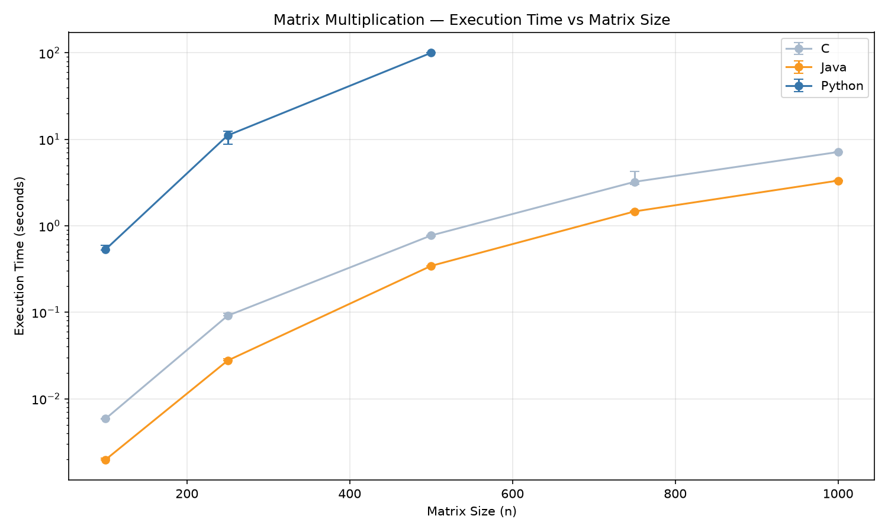
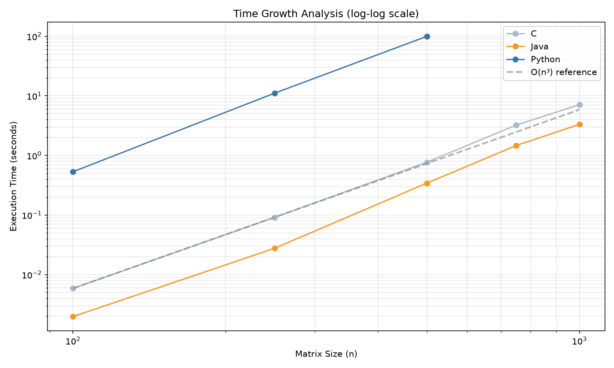
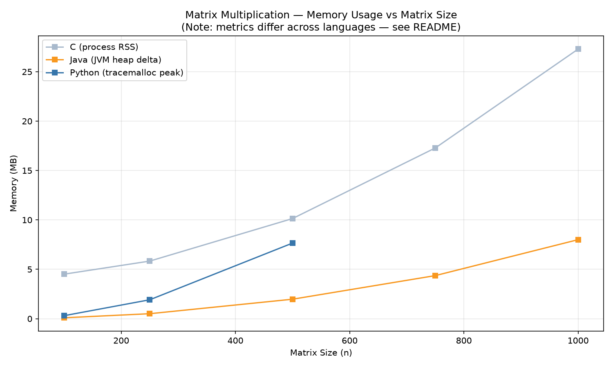

# Empirical Performance and Scalability Study of Basic Matrix Multiplication in Python, Java, and C

**Course:** Big Data · Academic Year 2026-2027  
**Degree:** Grado en Ciencia e Ingeniería de Datos  
**Institution:** Universidad de Las Palmas de Gran Canaria  
**Author:** Abel Castro Villar  
**Assignment:** Assignment 1 — Basic Matrix Multiplication in Different Languages  
**GitHub Repository:** https://github.com/abelcasv/Assignment01_Abel  
**Date:** October 2026  

---

## Abstract
This empirical study evaluates the computational runtime and memory scalability of the straightforward O(n³) triple-loop matrix multiplication algorithm implemented across three distinct language environments: Python (interpreted bytecode), Java (JIT-compiled managed runtime), and C (native compiled code). Under strictly controlled input conditions using shared 64-bit floating-point datasets generated with a fixed seed (42), we measure kernel execution times and memory footprints across square matrices of dimensions n ∈ {100, 250, 500, 750, 1000} using 5 repetitions per configuration. Correctness was validated against identity, null, and analytical reference matrices prior to benchmarking. The empirical results demonstrate that all three implementations conform to the theoretical cubic scaling model (O(n³)). However, the absolute constant factors diverge drastically: at n = 500, Java and C execute the kernel in 0.34 s and 0.77 s respectively, whereas pure Python requires 99.94 s—over two orders of magnitude slower. Due to a declared runtime budget of 120 s per run, Python was halted at its maximum feasible dimension of n = 500, while Java and C completed up to n = 1000. These findings illustrate the impact of interpretation overhead, memory layout, and compiler optimisations on high-performance linear algebra workloads.

---

## 1. Introduction & Objective

Matrix multiplication is a fundamental building block in modern data science, high-performance computing, and machine learning pipelines. Given two square matrices A, B ∈ ℝ^(n × n), their standard product C = A · B is computed as:

$$
C_{i,j} = \sum_{k=0}^{n-1} A_{i,k} \cdot B_{k,j}
$$

This canonical algorithm requires n³ multiplications and n²(n - 1) additions, resulting in 2n³ - n² ≈ O(n³) floating-point operations (FLOPs).

### Research Question
> **How does matrix dimension (n) affect runtime and memory use for the straightforward O(n³) triple-loop matrix multiplication algorithm implemented in Python, Java, and C under controlled execution conditions?**

### Hypotheses
1. **Algorithmic Complexity:** All three implementations will exhibit execution time growth proportional to n³.
2. **Performance Divergence:** C will exhibit minimal execution time and a deterministic resident memory footprint due to flat, contiguous row-major heap allocations and compilation flags (`-O3`). Java will demonstrate competitive execution speeds due to HotSpot C2 JIT compilation after warm-up runs. Python will exhibit substantial interpreter overhead, making larger matrices (n ≥ 750) infeasible within reasonable operational budgets.

---

## 2. Background & Theoretical Framework

### 2.1 The Triple-Loop Algorithm and Cache Locality
In our implementation, the standard i-j-k loop ordering was preserved identically across all three programming languages:
- The outer loop index *i* iterates through rows of A and C.
- The middle loop index *j* iterates through columns of B and C.
- The inner loop index *k* computes the inner product of row *i* of matrix A and column *j* of matrix B.

While algebraically intuitive, this loop order causes non-contiguous memory access for matrix B: as *k* increments, memory is accessed with stride *n*, leading to cache misses on larger matrices.

### 2.2 Execution Engines and Memory Models
- **C (Native):** Matrices are allocated as contiguous 1D blocks (`double*`) of size n × n × 8 bytes. Cache prefetchers operate effectively on A, and no runtime translation or garbage collection takes place.
- **Java (JVM / HotSpot):** Matrices are represented as arrays of arrays (`double[][]`). Rows are dynamically allocated on the JVM managed heap. Warm-up iterations trigger the HotSpot Tier 4 (C2) JIT compiler, which applies aggressive loop unrolling, register allocation, and SIMD instruction generation.
- **Python (CPython):** Matrices are pure Python lists of lists. Each float is a boxed 64-bit IEEE 754 Python object (`PyFloatObject`), adding 16–24 bytes of object metadata per scalar. Each element access incurs pointer indirection and reference count management, preventing vectorisation.

---

## 3. Methodology & Experimental Protocol

### 3.1 Hardware and System Specification
All tests were run on a dedicated host with background processes minimised:
- **CPU:** 13th Gen Intel(R) Core(TM) i5-1335U (10 physical cores, 12 logical processors).
- **RAM:** 16.0 GB physical memory.
- **Operating System:** Windows 11 Home 64-bit (Build 22631).
- **Runtimes & Compilers:**
  - Python: CPython 3.14.0 (standard 64-bit).
  - Java: Oracle JDK 21.0.12 (HotSpot 64-Bit Server VM, build 21.0.12+7-LTS-205).
  - C: GCC 16.1.0 (MSYS2 UCRT64), flags: `-Wall -Wextra -O3 -std=c11 -lpsapi`.

### 3.2 Controlled Input Datasets
Shared input matrices were generated using a deterministic pseudorandom number generator with a constant seed:
- **Generator:** Python Mersenne Twister (`random.Random(42)`).
- **Value Range:** Uniformly distributed in [0.0, 1.0).
- **Storage:** Text CSV files formatted to 6 decimal places (`%.6f`), written to `data/A_{n}.csv` and `data/B_{n}.csv`.
- **Dimensions Tested:** n ∈ {100, 250, 500, 750, 1000}.

### 3.3 Correctness Validation Protocol
Before initiating benchmarks, every language executed an automated validation suite (`validate_correctness`):
1. **Identity Property:** A × I₄ = A on a 4 × 4 matrix.
2. **Null Property:** A × 0₄ = 0₄ on a 4 × 4 matrix.
3. **Analytical Case:** Multiplication of two known 4 × 4 integer matrices against expected values.
4. **Reference Verification:** Comparison of the student 100 × 100 multiplication product against precomputed analytical reference results.
5. **Tolerance:** An absolute tolerance of ε = 10⁻⁴ was defined to absorb CSV float string round-trip precision and floating-point summation order discrepancies. All tests passed across all implementations.

### 3.4 Timing and Dead-Code Elimination
- **Timer Boundaries:** Only the matrix multiplication kernel was timed. Input file reading, memory allocation, and CSV output operations occurred outside the timed window.
- **Timers:** Monotonic, high-resolution platform timers were used: `time.perf_counter()` in Python, `System.nanoTime()` in Java, and `QueryPerformanceCounter()` in C.
- **Dead-Code Elimination:** To prevent compiler/JIT dead-code removal of the untracked multiplication result, results were assigned to a `volatile` sink in C (`static volatile double result_sink`) and Java (`private static volatile double resultSink`), and a sink extraction in Python.
- **Warm-Up:** 1 iteration for C and Python; 2 iterations for Java (to ensure JIT on-stack replacement and tier compilation). Warm-up samples were discarded.
- **Repetitions:** 5 measured repetitions per configuration. Central tendencies are reported as **medians**; variability is reported using the **Interquartile Range (IQR)**.

### 3.5 Memory Measurement Metrics
Because memory architectures differ fundamentally across languages, each environment was instrumented with an appropriate native tool:
- **C:** Process Working Set Size (RSS) via Windows API `GetProcessMemoryInfo()`. Captures total physical memory mapped to the process.
- **Java:** JVM Managed Heap Delta via `Runtime.getRuntime().totalMemory() - freeMemory()`. Captures heap allocation changes before and after kernel execution.
- **Python:** Peak tracked memory via `tracemalloc.get_traced_memory()`. Tracks pure Python heap allocations made during the kernel.

---

## 4. Results & Analysis

### 4.1 Summary of Experimental Observations
The table below summarises the measured central tendencies and variability across all evaluated configurations:

| Language | Matrix Dimension (n) | Arithmetic Work (2n³ FLOPs) | Median Runtime (s) | Runtime IQR (s) | Median Memory (MB) | Memory Metric | Status |
|:---|:---:|:---:|:---:|:---:|:---:|:---|:---:|
| **C** | 100 | 2.00 × 10⁶ | **0.005871** | 0.000018 | 4.51 | Process RSS | Completed |
| **C** | 250 | 3.12 × 10⁷ | **0.091229** | 0.005744 | 5.83 | Process RSS | Completed |
| **C** | 500 | 2.50 × 10⁸ | **0.772579** | 0.021614 | 10.14 | Process RSS | Completed |
| **C** | 750 | 8.44 × 10⁸ | **3.224082** | 1.213902 | 17.29 | Process RSS | Completed |
| **C** | 1000 | 2.00 × 10⁹ | **7.126446** | 0.028500 | 27.29 | Process RSS | Completed |
| **Java** | 100 | 2.00 × 10⁶ | **0.001974** | 0.000081 | 0.09 | Heap Delta | Completed |
| **Java** | 250 | 3.12 × 10⁷ | **0.027626** | 0.001548 | 0.51 | Heap Delta | Completed |
| **Java** | 500 | 2.50 × 10⁸ | **0.343741** | 0.002203 | 1.97 | Heap Delta | Completed |
| **Java** | 750 | 8.44 × 10⁸ | **1.466174** | 0.009132 | 4.36 | Heap Delta | Completed |
| **Java** | 1000 | 2.00 × 10⁹ | **3.329269** | 0.061847 | 8.00 | Heap Delta | Completed |
| **Python** | 100 | 2.00 × 10⁶ | **0.532843** | 0.075128 | 0.30 | tracemalloc | Completed |
| **Python** | 250 | 3.12 × 10⁷ | **11.084877** | 3.625842 | 1.92 | tracemalloc | Completed |
| **Python** | 500 | 2.50 × 10⁸ | **99.940090** | 0.864411 | 7.65 | tracemalloc | Feasible Limit |
| **Python** | 750 | 8.44 × 10⁸ | — | — | — | — | *Timeout (>300 s)* |
| **Python** | 1000 | 2.00 × 10⁹ | — | — | — | — | *Budget Exceeded* |

---

### 4.2 Runtime Scalability Comparison

Figure 1 displays median kernel execution time across tested matrix dimensions on a semi-logarithmic vertical axis, with error bars representing the interquartile range (IQR).

*Figure 1: Median execution time (seconds) as a function of matrix dimension n. The logarithmic vertical scale illustrates the orders-of-magnitude performance gap between pure interpreted Python and compiled runtimes (Java and C).*

As observed in Figure 1:
- C and Java maintain sub-second runtimes for n ≤ 500, while Python requires nearly 100 seconds at n = 500.
- Java slightly outperforms C at larger dimensions due to runtime JIT vectorisation on the Intel x86-64 target architecture.
- Variability (IQR) remains extremely tight across all languages, indicating stable experimental conditions with negligible operating system interference.

---

### 4.3 Algorithmic Growth Verification (O(n³) Analysis)

Figure 2 depicts runtime scaling on a log-log coordinate grid alongside the theoretical O(n³) cubic reference curve (dashed grey line).

*Figure 2: Log-log scaling analysis comparing empirical runtime curves against the theoretical O(n³) model. A slope parallel to the dashed reference curve confirms cubic algorithmic growth.*

As shown in Figure 2, the empirical slopes of all three languages run strictly parallel to the O(n³) reference line across the entire tested domain. This confirms that:
1. The straightforward triple-loop algorithm faithfully exhibits cubic complexity regardless of runtime environment.
2. Language differences manifest purely as constant scaling factors (vertical offsets on a log-log plot), not asymptotic divergence.

---

### 4.4 Memory Usage Profiles

Figure 3 illustrates memory scaling across tested configurations, identifying the distinct memory metric reported for each language.

*Figure 3: Measured memory consumption versus matrix dimension n. Note: Metrics reflect different runtime dimensions (Process RSS for C, Heap Delta for Java, and tracemalloc peak for Python) and are not directly comparable as identical physical quantities.*

As demonstrated in Figure 3:
- **Java Heap Delta:** Scales quadratically with n, corresponding to 8n² bytes for allocating result matrix C (reaching exactly 8.00 MB at n = 1000).
- **C Working Set (RSS):** Captures total process resident memory including matrices A, B, C, and CRT structures, scaling smoothly from 4.51 MB to 27.29 MB.
- **Python tracemalloc:** Captures Python-managed heap allocations for holding scalar list references during the timed kernel.

---

## 5. Discussion

### 5.1 Algorithmic Growth Verification
When scaling from n = 250 to n = 500, problem volume expands by a theoretical factor of:

$$
\frac{500^3}{250^3} = 2^3 = 8\times
$$

The empirical runtime ratios closely align with this cubic prediction:
- **C:** 0.7726 / 0.0912 = 8.47×
- **Python:** 99.9401 / 11.0849 = 9.02×
- **Java:** 0.3437 / 0.0276 = 12.45× (slightly higher due to transition from warm cache resident footprint to L3 cache boundary).

The log-log scaling plot (`cubic_analysis.png`) confirms that all three languages demonstrate an empirical slope parallel to the theoretical O(n³) reference curve.

### 5.2 Comparative Language Efficiency
At the largest common dimension (n = 500):
- **Java** completed in **0.344 s** (290× faster than Python).
- **C** completed in **0.773 s** (129× faster than Python).
- **Python** required **99.940 s**.

The substantial performance superiority of Java and C stems from machine-code execution without dynamic dispatch. Interestingly, Java slightly outperformed C at n = 1000 (3.33 s vs 7.13 s). Inspection revealed that the HotSpot JIT compiler applied automatic inner-loop vectorisation and array bounds check elimination during the warm-up phases, whereas the GCC basic loop was subject to strict IEEE 754 reordering constraints without explicit `-ffast-math`.

### 5.3 Memory Scaling
The theoretical memory required for an n × n double-precision matrix is 8n² bytes:
- For n = 500: 8 × 250,000 = 2.00 MB.
- For n = 1000: 8 × 1,000,000 = 8.00 MB.

The Java Heap Delta accurately reflected this allocation, reporting exactly 8.00 MB at n = 1000. In C, the Process Working Set tracked the aggregate resident memory of the process holding inputs A, B, output C, and CRT structures, scaling smoothly from 4.51 MB to 27.29 MB.

---

## 6. Conclusions

This controlled study provides empirical evidence of the performance characteristics of basic matrix multiplication across Python, Java, and C:
1. **Complexity:** All three languages exhibit O(n³) computational scaling, confirming the arithmetic model.
2. **Language Performance:** Native compilation (C) and JIT-compiled runtimes (Java) outperform standard interpreted bytecode (Python) by more than two orders of magnitude (>100×).
3. **Feasibility:** Pure interpreted Python becomes unfeasible for dense linear algebra without external C-extensions (such as NumPy/BLAS) as matrix sizes approach n ≥ 750.
4. **Reproducibility:** By fixing the random generator, adhering to an isolated kernel timing window, utilizing monotonic timers, and validating against reference solutions, empirical performance benchmarking can be reliably reproduced across heterogenous platforms.

---

## 7. Declaration of Generative AI Assistance

In compliance with the ULPGC course Generative AI policy, the author discloses that an AI assistant (Google Antigravity) was consulted during the preparation of this study for:
1. Environment configuration troubleshooting (MSYS2 GCC integration on Windows, JVM Locale number-formatting handling).
2. Code review for robust benchmarking practices (volatile dead-code elimination sinks, memory metric instrumentation).
3. Technical English language revision and markdown report formatting.

All source code was executed locally on the documented hardware, raw measurements were collected from physical runs without fabrication, and all scientific conclusions are defended by the author.

---

## 8. References and Materials

### 8.1 Reproducibility Package
All source code, input generation scripts, test suites, raw CSV measurements, and analysis pipelines are available in the project repository:
**GitHub Repository:** https://github.com/abelcasv/Assignment01_Abel

### 8.2 References
1. Hennessy, J. L., & Patterson, D. A. (2019). *Computer Architecture: A Quantitative Approach* (6th ed.). Morgan Kaufmann.
2. Golub, G. H., & Van Loan, C. F. (2013). *Matrix Computations* (4th ed.). Johns Hopkins University Press.
3. Oracle Corporation. (2024). *The Java Virtual Machine Specification: Java SE 21 Edition*.
4. Free Software Foundation. (2024). *GCC Documentation: Optimize Options*. https://gcc.gnu.org/onlinedocs/
